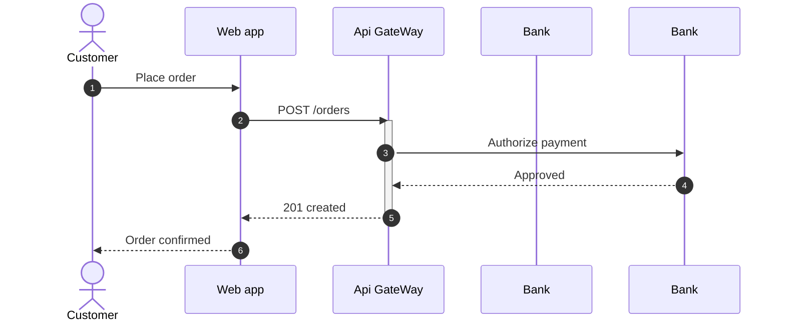

# This is a sample Diagram


## 1. flow chart Diagram

[//]: # (```mermaid)

[//]: # ()
[//]: # (flowchart LR)

[//]: # (    A[Start] --> B{Choose Path})

[//]: # (    B -->|Option 1| C[Path 1])

[//]: # (    B -->|Option 2| D[Path 2])

[//]: # (  ```)

[//]: # ()
[//]: # (## Sequence Diagram)

[//]: # ()
[//]: # (```mermaid)

[//]: # (sequenceDiagram )

[//]: # (    Alice ->> John: Hello John, how are you?)

[//]: # (    John -->>Alice: Great!)

[//]: # (    Alice ->> John: See you later!)

[//]: # (```)

